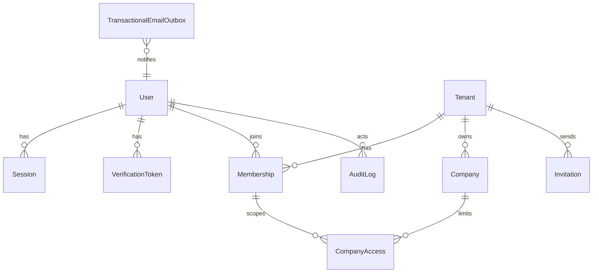
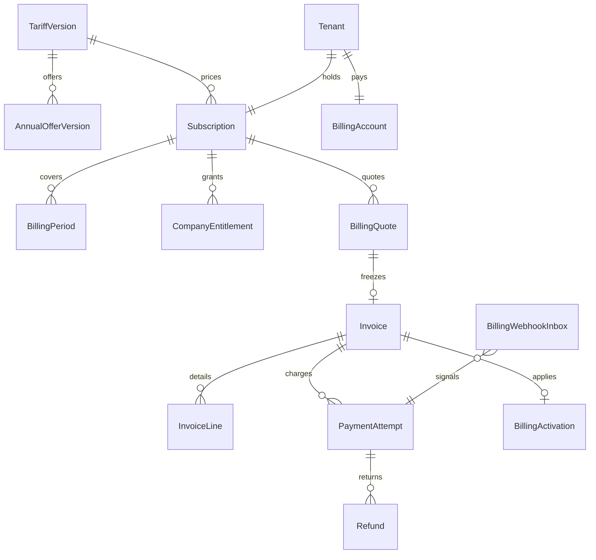

# Модель данных

Версия документа: 1.0. Соответствует ТЗ v2.0, §4–7 и §18.

Общие правила: UUID PK, `timestamptz` в UTC для технического времени, `DATE` для бизнес-дат, `tenant_id` обязателен для данных клиента, исторические ценовые snapshots неизменяемы. Суммы `NUMERIC(20,2)`, проценты `NUMERIC(12,6)`.

На этапах 1–2 создаются таблицы ниже. Остальные сущности ТЗ перечислены в конце и появятся на своих этапах.

## Этап 1. Пользователи и пространство

- `User`: email, `normalized_email` UNIQUE (trim + lower, точки и plus-теги сохраняются), `password_hash`, `email_verified_at`, status, `password_changed_at`.
- `Session`: hash opaque-токена, CSRF-секрет, idle и absolute сроки, `revoked_at`.
- `VerificationToken`: hash, purpose (`verify_email`, `reset_password`, `change_email`, `invite`), TTL, `used_at`. Потребление атомарное.
- `Tenant`: name, `default_timezone`.
- `Membership`: tenant, user, role, status. UNIQUE (tenant, user).
- `Company`: kind (`company`/`ip`), currency `RUB`, timezone, status (`draft`/`active`/`archived`), `min_cash_reserve`. ИНН уникален среди неархивных в tenant.
- `CompanyAccess`: ограничение фирм поверх роли. У operator дополнительно будет `WalletAccess` (этап 3).
- `Invitation`: email, role, hash токена, TTL 48ч. Принятие добавляет membership, подписку не создаёт.
- `TransactionalEmailOutbox`: тип, получатель, шаблон, redacted payload, idempotency key, статус.
- `AuditLog`: действие, сущность, redacted before/after, `request_id`.

Роли membership: `owner`, `finance_manager`, `accountant`, `viewer`, `operator`, `billing_manager`.

## Этап 2. Billing продавца

- `TariffVersion` и `AnnualOfferVersion` неизменяемы (триггер запрещает UPDATE/DELETE). Seed: beta, первая фирма 2500, следующая 1500, скидка 15%, `approved_at` 2026-10-14, `approval_source=user`.
- `BillingAccount`: плательщик и принятая версия оферты. `billing_email` может отличаться от login email.
- `Subscription`: status, `company_limit`, `current_interval`, `scheduled_interval`, `paid_through`, `billing_anchor`, timezone, `auto_renew=false`, `scheduled_company_limit`, revision, `cancel_renewal`.
- `BillingPeriod`: полуинтервал `[start_at, end_at)`, snapshot месячной базы и процента скидки, оплаченная сумма, invoice активации.
- `CompanyEntitlement`: какая фирма входит в оплаченный слот и до какого момента.
- `BillingQuote`: TTL 15 минут, revision, суммы. Клиентская цена не сохраняется как источник истины.
- `Invoice` и `InvoiceLine`: неизменяемый снимок цены. Сумма строк равна `payable_amount`.
- `PaymentAttempt`: провайдер `yookassa`, `provider_payment_id` UNIQUE, `idempotence_key` UNIQUE, `request_hash`, `test_mode`.
- `BillingWebhookInbox`: событие сохраняется до обработки. UNIQUE по провайдеру, объекту, событию и hash payload.
- `BillingActivation`: UNIQUE `invoice_id`. Одна активация на счёт.
- `Refund`: только для сотрудников продавца. В beta создание живого возврата выключено.
- `BillingAudit`: доказательства изменений подписки.
- `IdempotencyKey`: ключ checkout, hash запроса, сохранённый ответ.

Статусы подписки: `awaiting_payment`, `active`, `grace`, `expired`, `cancelled`. Флаг отмены продления не обнуляет оплаченный срок.

## RLS

Политики на таблицах с `tenant_id`. В транзакции выставляются `app.tenant_id` и `app.user_id`. Роль приложения без `BYPASSRLS`. Таблицы аутентификации (`users`, `sessions`, `verification_tokens`) без RLS: они читаются до выбора tenant. `memberships` видны самому пользователю и внутри его tenant.

`tariff_versions` и `annual_offer_versions` глобальные и только для чтения приложением.

## Созданные таблицы этапов 3–4

Этап 3 (`0003_cash`): `Wallet`, `WalletAccess`, `CashTransaction`, `CashAllocation`, `TransactionRevision`, `TransferGroup`, `OpeningBalance`, `BalanceSnapshot`, `Reconciliation`, `CashCategory`.

Этап 4 (`0004_import`): `SourceConnection`, `ImportProfile`, `ImportBatch`, `RawImportRow`, `SourceIdentity`, `ClassificationRule`. У операции есть текстовые `counterparty_inn` и `counterparty_name`. Контракты файлов — в `docs/import-formats.md`.

Этап 5 (`0005_revenue`): `Direction`, `Counterparty`, `RevenueEntry`, `RevenueCashMatch`. У источника есть `dataset` и `coverage_through`.

## Последующие этапы (таблицы ещё не создаются)

Этап 5 закрыт по таблицам выше. `CompanyCategoryMap` не создаётся.

Этап 6: `PlannedCashEvent`, `PaymentMatch`, `RecurrenceRule`, `Obligation`, `ObligationCashLink`, `ForecastRun`, `ForecastPoint`, `ForecastContribution`.

Этап 7: `BudgetVersion`, `BudgetLine`, `BudgetDailyAllocation`, `AlertRule`, `Alert`.

Этап 8: `TelegramBinding`, `TelegramLinkToken`, `DigestSubscription`, `DigestSnapshot`, `NotificationOutbox`, `TelegramUpdate`, `BotDraft`.

Этап 9: `EmailIngestion`.
